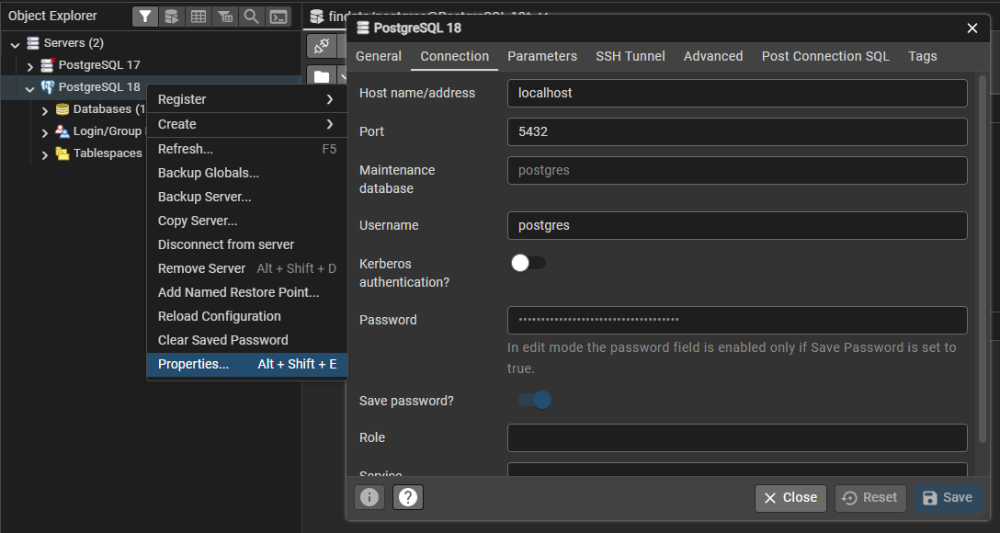

# Mini-LMS — Setup Guide

## 1. Quickstart

**Prerequisites:** Git, Python 3.11+, PostgreSQL 17

```bash
git clone https://github.com/SE-FDA-NEU-AI66B/AI66B-G3-D3-Mini-LMS.git
cd AI66B-G3-D3-Mini-LMS

python -m venv .venv
source .venv/bin/activate             # Windows PowerShell: .venv\Scripts\Activate.ps1
pip install -r requirements.txt

cp .env.example .env                  # Windows CMD: copy .env.example .env
# Edit .env: set DB_USER and DB_PASSWORD for your OS.

python db/init_db.py
python src/app.py
```

Then open **http://localhost:8000/login** and sign in with any account in `db/seed.sql.txt`.

---

## 2. Prerequisites

| Tool | Minimum | Download |
|---|---|---|
| Git | 2.40 | <https://git-scm.com/downloads> |
| Python | 3.11 | <https://www.python.org/downloads/> |
| PostgreSQL | 17 | <https://www.enterprisedb.com/downloads/postgres-postgresql-downloads> |
| pgAdmin 4 *(optional)* | 9.15 | <https://www.pgadmin.org/> |

### 2.1 Install PostgreSQL

**Windows** — run the EDB installer.
- Set the `postgres` superuser password to **`postgres`** (or write down what
  you choose — you'll need it in §3.3).
- Keep the default port **`5432`**.
- **After installation, open a new terminal** so `psql` is on PATH.

**macOS (Homebrew)**:
```bash
brew install postgresql@17
brew services start postgresql@17
echo 'export PATH="/opt/homebrew/opt/postgresql@17/bin:$PATH"' >> ~/.zshrc
exec zsh
```
Homebrew creates a superuser matching your macOS username with **no password**.

**Linux (Ubuntu / Debian)**:
```bash
sudo apt update && sudo apt install -y postgresql-17
sudo systemctl start postgresql
sudo -u postgres psql -c "ALTER USER postgres PASSWORD 'postgres';"
```

Confirm the server is reachable — you may be asked for the password you just
set (on macOS Homebrew just press Enter):

```bash
psql -U postgres -h localhost -c "SELECT version();"
```

You should see a line beginning with `PostgreSQL 17.x`.

---

## 3. Full step-by-step

### 3.1 Clone the repository

```bash
git clone https://github.com/SE-FDA-NEU-AI66B/AI66B-G3-D3-Mini-LMS.git
cd AI66B-G3-D3-Mini-LMS
```

### 3.2 Virtual environment + dependencies

```bash
python -m venv .venv
```

**Activate** — pick your shell:

- macOS / Linux: `source .venv/bin/activate`
- Windows PowerShell: `.venv\Scripts\Activate.ps1`
- Windows CMD: `.venv\Scripts\activate.bat`

You should now see `(.venv)` at the start of your prompt.

**Install:**

```bash
pip install -r requirements.txt
```

> **Windows: `Activate.ps1 cannot be loaded because running scripts is disabled`.**
> PowerShell blocks the activation script. Run this once, answer `Y`, then
> re-activate:
> ```powershell
> Set-ExecutionPolicy -Scope CurrentUser -ExecutionPolicy RemoteSigned
> ```

### 3.3 Configure the environment

```bash
cp .env.example .env          # Windows CMD: copy .env.example .env
```

Open `.env` in any editor and fill in `DB_USER` / `DB_PASSWORD` for your OS:

| OS | `DB_USER` | `DB_PASSWORD` |
|---|---|---|
| Windows | `postgres` | the password you set during install (default `postgres`) |
| macOS (Homebrew) | *your macOS username* | *(leave blank)* |
| Linux (apt) | `postgres` | `postgres` |

Also set **`DB_NAME=minilms`**. That isolates Mini-LMS tables from any
pre-existing `postgres` DB. The init script creates the database if it doesn't
already exist.

Your `.env` should end up looking like this (adjust the two password fields):

```
DB_HOST=localhost
DB_PORT=5432
DB_NAME=minilms
DB_USER=postgres
DB_PASSWORD=postgres
SESSION_SECRET=change-me
SSO_MOCK_BASE_URL=http://localhost:8000/mock-sso
```

> **`.env` is git-ignored.** Verify with `git check-ignore -v .env` — the
> output should mention `.gitignore`. Never commit it.

If your machine has pgAdmin 4 installed, this is where you find your local
database properties in pgAdmin:



### 3.4 Create and seed the database

```bash
python db/init_db.py
```

Expected output on the first run:

```
Target: postgres@localhost:5432/minilms

Database 'minilms' not found — creating it ...
Running schema and seed ...
  → db/schema.sql.txt
  → db/seed.sql.txt

Database initialised.
  users       : 13
  courses     : 3
  enrollments : 20
  quizzes     : 15
  questions   : 60
  options     : 120
  attempts    : 2
  answers     : 8
```

Safe to re-run: it drops and recreates every table, then reseeds.

### 3.5 Verify the database

```bash
python db/verify_db.py
```

Expected output — the walking-skeleton SQL returns 6 quizzes for the seeded
student:

```
ID    Course    Title                       Due                Limit
--------------------------------------------------------------------------
2     ACC101    ACC101 Weekly Quiz 1        2026-11-01 23:59    15 min
6     ACC201    ACC201 Weekly Quiz 1        2026-11-03 23:59    15 min
3     ACC101    ACC101 Weekly Quiz 2        2026-11-08 23:59    15 min
7     ACC201    ACC201 Weekly Quiz 2        2026-11-10 23:59    15 min
1     ACC101    ACC101 Midterm Quiz         2026-11-15 23:59    30 min
5     ACC201    ACC201 Midterm Quiz         2026-11-18 23:59    30 min

6 quiz(zes) fetched from the database. Walking skeleton OK.
```

> **If it says `No visible quizzes for this student`**, the clock on your
> machine is past 2026-12-14 — every seeded quiz has expired. Fix it with one
> command, then re-run `python db/verify_db.py`:
> ```bash
> psql -U postgres -h localhost -d minilms -c "UPDATE quiz SET due_at = due_at + INTERVAL '1 year';"
> ```
> *(The web app itself is unaffected — the dashboard shows overdue quizzes
> too — but `verify_db.py` still uses the original M2 SQL that filters on
> `due_at > NOW()`.)*

### 3.6 Start the server

```bash
python src/app.py
```

You should see a banner, then uvicorn's startup lines:

```
Mini-LMS is starting. Open one of these in your browser:
  http://localhost:8000/login
  ...
INFO:     Uvicorn running on http://0.0.0.0:8000 (Press CTRL+C to quit)
INFO:     Application startup complete.
```

Leave this terminal open. For any other command, open a **new** terminal.

Do **not** try to open `http://0.0.0.0:8000` in a browser — `0.0.0.0` is a
bind address, not a hostname. Always use `localhost` or `127.0.0.1`.

---

## 4. Test accounts

Every seeded account uses the password **`password123`**. (Stored in the DB
as SHA-256 hex digests; see `db/seed.sql.txt`.)

| Role | Email | Password |
|---|---|---|
| **Admin** | `admin@univ.edu` | `password123` |
| **Lecturer** | `lanpt@univ.edu` | `password123` |
| **Lecturer** | `tuanvm@univ.edu` | `password123` |
| **Student** | `minhhd@univ.edu` | `password123` |
| **Student** | `anhnv@univ.edu` | `password123` |

After signing in at **http://localhost:8000/login**, each role lands on its
home page:

| Role | Lands on |
|---|---|
| Admin | `/ui/html/admin-accounts.html` |
| Lecturer | `/ui/html/instructor-quizzes.html` |
| Student | `/ui/html/student-dashboard.html` |

---

## 5. First-run walkthrough

Verify the setup by doing these three things — one per role.

1. **Student takes a quiz**
   Sign in as `minhhd@univ.edu` / `password123`. From the dashboard, click
   **Take** on any quiz. The countdown timer starts. Answer a couple of
   questions, click **Submit quiz**, and confirm the result page shows a
   score of the form `X / Y`.

2. **Lecturer publishes a quiz**
   Sign in as `lanpt@univ.edu` / `password123`. From **My quizzes**, find any
   row with a `Draft` status badge and click **Publish**. It should move to
   `Published`.

3. **Admin creates a course**
   Sign in as `admin@univ.edu` / `password123`. Go to **Courses** →
   **+ New course**, fill the form (assign one of the seeded lecturers from
   the dropdown), and click **Save course**. It should appear in the course
   list.

If all three work, the fresh-machine setup is complete.

---

## 6. Troubleshooting

**`git: command not found`** — Git is not installed. Install from
<https://git-scm.com/downloads> and open a **new** terminal.

**`psql: command not found`**
- Windows: open a **new** terminal after installation.
- macOS: verify `export PATH="/opt/homebrew/opt/postgresql@17/bin:$PATH"` is
  in `~/.zshrc`, then `exec zsh`.
- Linux: reinstall with `sudo apt install postgresql-17`.

**`could not connect to server: Connection refused`** — the PostgreSQL
service is not running.
- Windows: *Services* → `postgresql-x64-17` → **Start**.
- macOS: `brew services start postgresql@17`.
- Linux: `sudo systemctl start postgresql`.

**`password authentication failed for user "postgres"`** — the
`DB_PASSWORD` in `.env` is wrong.
- Linux reset:
  ```bash
  sudo -u postgres psql -c "ALTER USER postgres PASSWORD 'postgres';"
  ```
- macOS Homebrew: leave `DB_PASSWORD=` blank and set `DB_USER` to your macOS
  username.

**`ModuleNotFoundError: psycopg`** / **`ModuleNotFoundError: fastapi`** — the
virtual environment isn't active, or deps weren't installed:
```bash
source .venv/bin/activate           # Windows: .venv\Scripts\Activate.ps1
pip install -r requirements.txt
```

**`ERROR: Could not find a version that satisfies the requirement httpx2`**
This is the `requirements.txt` typo. Delete the line `httpx2==2.13.1` from
`requirements.txt` and re-run `pip install -r requirements.txt`.

**`No visible quizzes for this student`** — your clock is past 2026-12-14.
Fix:
```bash
psql -U postgres -h localhost -d minilms -c "UPDATE quiz SET due_at = due_at + INTERVAL '1 year';"
```

**`Address already in use: port 8000`** — another process holds port 8000.
Either stop it, or edit `src/app.py` and change `port=8000` to `port=8001`,
then visit `http://localhost:8001/login`.

**Browser shows `ERR_ADDRESS_INVALID` for `http://0.0.0.0:8000/`** —
`0.0.0.0` is a bind address, not a hostname. Use
`http://localhost:8000/login` instead.

**Want to reset the database?** Just re-run `python db/init_db.py`. It drops
and recreates every table, then reseeds.

---

## 7. Tested by

| Tester | Team | Machine | OS | Time |
|---|---|---|---|---|
| Nguyen Do Anh Duong (@aizun) | 02 | Lenovo LOQ | Windows 11 | 10 minutes |