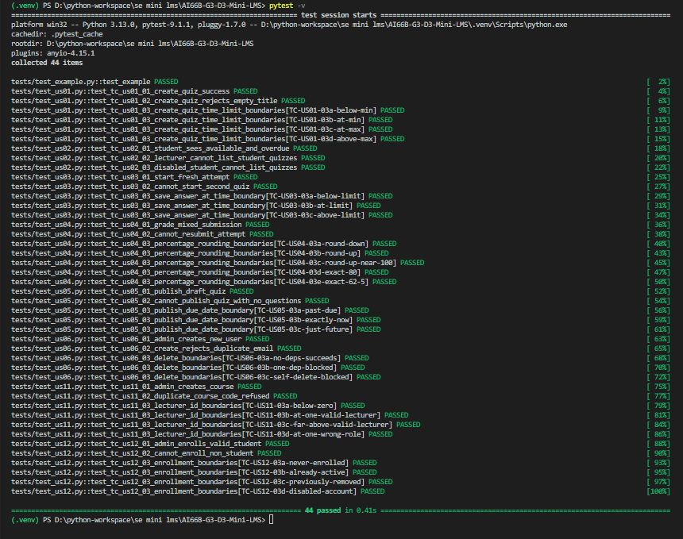
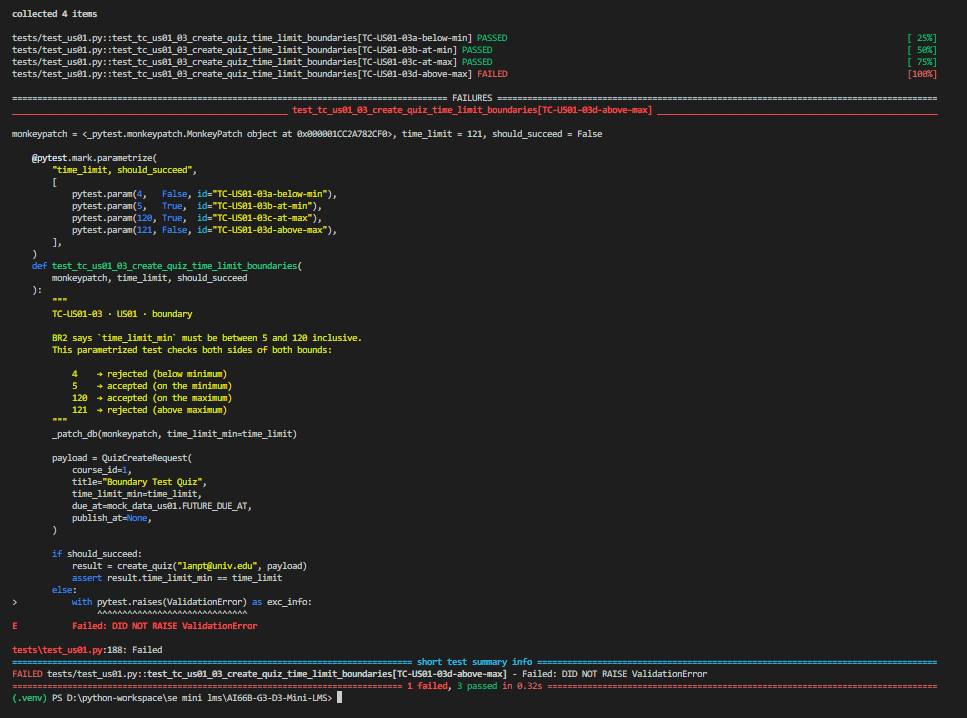

# Mini-LMS — Testing

## 1. What we test, and why

| Layer | Test type | Why |
|---|---|---|
| **`src/services/`** — business logic | Unit tests with fake repositories (24 test functions across 8 files, expanded to 43 executed cases) | Every business rule lives here — BR2 (time limit), BR3 (auto-submit), BR4 (grading), BR5 (percentage rounding), BR6 (visibility), BR8 (role gates), BR9 (lecturer demotion), device lease. A change here reaches every request of that type. |
| **`src/repositories/`** — SQL | None automated; verified manually with `db/init_db.py` + `db/verify_db.py` | The schema is PostgreSQL-only — real ENUM types, `SERIAL`, and the partial unique index `attempt_one_active`. A test-only substitute would either lose fidelity (SQLite can't express any of the three) or add a live Postgres dependency to `SETUP.md` and to CI, contradicting the milestone's "no server, no real database" rule. Manual verification against the seeded DB is faithful and cheap. |
| **`src/routes/`** — HTTP layer | None automated | Every route is a three-line wrapper: `email = Depends(current_email)` → `service.foo(email, payload)` → `return result`. All logic is in the service layer (tested above); the only behaviour to test here is "the route returns 200 / 4xx," which is already proven end-to-end in `ui.md`. A test here would re-assert what a service test already covers, at the cost of spinning up FastAPI for every case. |
| **`src/ui/`** — interface | None automated | Manually checked with real users in M3. Selectors and page titles change every sprint; maintaining them would consume time for a layer that shows rather than computes. The interface is verified by the M3 walkthrough in `ui.md` and by `SETUP.md`. |

**Risk — where we put the most effort, and why.** The service layer received the most coverage — one test per business rule, plus both sides of every numeric boundary — because a wrong branch there reaches users fastest. A mistake in `_validate_time_limit`, `_grade_and_finalize`, or `_require_student` affects every request of that type across every student or lecturer. The two layers we left to manual verification are shallow wrappers whose only failure mode is "the SQL runs" or "the JSON serialises"; such a bug is visible on the very first click in `SETUP.md`, whereas a service bug can hide for a whole sprint before the next demo. Testing services hard is cheap insurance against the failure that costs the most.

---

## 2. Test cases for every P0 story

Every P0 story from `ui.md` §1 is represented. Rows marked `boundary` exercise both sides of the numeric or state limit named in the "Story / rule" column.

| ID | Story | Input | Expected result | Kind |
|---|---|---|---|---|
| **TC-US01-01** | US01 creates quiz | `title="Midterm Quiz"`, `time_limit=30`, future due, valid Lecturer | `QuizDetail(quiz_id=42, status="Draft", questions=[])` | normal |
| **TC-US01-02** | US01 | `title="   "` (whitespace only) | `ValidationError(422, "Title is required")`, no DB write | error |
| **TC-US01-03a** | US01 / BR2 | `time_limit=4` | `ValidationError(422, "…between 5 and 120")` | boundary — below min |
| **TC-US01-03b** | US01 / BR2 | `time_limit=5` | succeeds, `QuizDetail(time_limit_min=5)` | boundary — at min |
| **TC-US01-03c** | US01 / BR2 | `time_limit=120` | succeeds, `QuizDetail(time_limit_min=120)` | boundary — at max |
| **TC-US01-03d** | US01 / BR2 | `time_limit=121` | `ValidationError(422, "…between 5 and 120")` | boundary — above max |
| **TC-US02-01** | US02 sees available quizzes | Active Student enrolled in 2 courses; 4 published quizzes (2 future, 2 past due) | all 4 returned; `availability` correct per row | normal |
| **TC-US02-02** | US02 / BR8 | Active Lecturer calling `list_visible_quizzes` | `StudentNotFoundError("…not a student (role: Lecturer)")` | error |
| **TC-US02-03** | US02 / BR8 | Disabled Student calling `list_visible_quizzes` | `StudentNotFoundError("Account is disabled…")` | error — status boundary |
| **TC-US03-01** | US03 takes quiz | Student with no active attempt starts quiz 1 | `AttemptState(remaining_seconds=1800, saved_answers=[], flagged=False)`, 2 questions | normal |
| **TC-US03-02** | US03 / BR1 | Student already has active attempt on quiz 2, tries to start quiz 1 | `ConflictError(409)`, `extra.active_quiz_id=2`, no attempt created | error |
| **TC-US03-03a** | US03 / BR3 | `save_answer` at 1799 s elapsed (30-min limit = 1800 s) | saved | boundary — below limit |
| **TC-US03-03b** | US03 / BR3 | `save_answer` at exactly 1800 s | `ConflictError(409, "Time has expired. Submitting now.")` | boundary — at limit |
| **TC-US03-03c** | US03 / BR3 | `save_answer` at 1801 s | `ConflictError(409, "Time has expired. Submitting now.")` | boundary — above limit |
| **TC-US04-01** | US04 auto-grade | 4 questions: MCQ correct, MCQ wrong, SHORT "  Hà Nội " vs "Hà Nội" (AC3), SHORT "London" vs "Paris" | `SubmitResponse(score=2, total=4, percentage=50.0, auto_submitted=False)` | normal |
| **TC-US04-02** | US04 | Submit an already-submitted attempt | `ConflictError(409, "Attempt already submitted")`, `finalize_attempt` not called | error |
| **TC-US04-03a** | US04 / BR5 | `_percentage(1, 3)` | `33.33` — rounds down | boundary — below .xx5 |
| **TC-US04-03b** | US04 / BR5 | `_percentage(2, 3)` | `66.67` — rounds up | boundary — above .xx5 |
| **TC-US04-03c** | US04 / BR5 | `_percentage(7, 9)` | `77.78` — rounds up | boundary — above .xx5 |
| **TC-US04-03d** | US04 / BR5 | `_percentage(8, 10)` | `80.0` — exact | boundary — exact |
| **TC-US04-03e** | US04 / BR5 | `_percentage(5, 8)` | `62.5` — exact | boundary — exact |
| **TC-US05-01** | US05 publish | Draft quiz with 1 question, far-future due date | `QuizDetail.status="Published"`, `set_quiz_status` called once | normal |
| **TC-US05-02** | US05 | Draft quiz with 0 questions | `ValidationError(422, "Cannot publish a quiz with no questions")`, no write | error |
| **TC-US05-03a** | US05 / BR3-adjacent | `due_at = now − 1 s` | `ValidationError(422, "…due date has passed")` | boundary — past |
| **TC-US05-03b** | US05 / BR3-adjacent | `due_at = now` | `ValidationError(422)` — rule uses `<=` | boundary — at now |
| **TC-US05-03c** | US05 / BR3-adjacent | `due_at = now + 1 s` | `status="Published"`, succeeds | boundary — future |
| **TC-US06-01** | US06 manages accounts | Admin creates Student `newstudent@univ.edu` with valid password | `UserAdminResponse(user_id=20, …)`, `insert_user` called once, **password stored as SHA-256 hex, not plaintext** | normal |
| **TC-US06-02** | US06 | Admin creates user with email that already exists | `ConflictError(409, "Email … already in use")`, no insert | error |
| **TC-US06-03a** | US06 / delete-rule | Delete user 5, 0 dependencies, not self | `delete_user` called once | boundary — 0 deps |
| **TC-US06-03b** | US06 / delete-rule | Delete user 5, 1 course dependency | `ConflictError(409, "Cannot delete user…")` | boundary — ≥1 deps |
| **TC-US06-03c** | US06 / self-protect | Delete user 1 (self), 0 dependencies | `ConflictError(409, "cannot delete your own account")` | boundary — self |
| **TC-US11-01** | US11 creates course | `code="math201"` (lowercase), `name="Discrete Mathematics"`, `lecturer_id=2` (Lecturer) | `AdminCourseResponse(code="MATH201", lecturer_id=2, …)`, `insert_course` called with uppercased code | normal |
| **TC-US11-02** | US11 | `code="ACC101"` already exists | `ConflictError(409, "Course code 'ACC101' already exists.")`, no insert | error |
| **TC-US11-03a** | US11 / numeric | `lecturer_id=0` | rejected by Pydantic at request construction (`gt=0`) | boundary — below >0 |
| **TC-US11-03b** | US11 / numeric | `lecturer_id=1`, role=`Lecturer` | `AdminCourseResponse(lecturer_id=1)`, succeeds | boundary — at boundary |
| **TC-US11-03c** | US11 / numeric | `lecturer_id=100`, role=`Lecturer` | `AdminCourseResponse(lecturer_id=100)`, succeeds | boundary — above |
| **TC-US11-03d** | US11 / role | `lecturer_id=1`, role=`Admin` | `ValidationError(422, "…must be a valid Lecturer")` | boundary — role mismatch |
| **TC-US12-01** | US12 enrolls student | Enroll Active Student, no prior enrollment | `upsert_enrollment(course, student, "Active")` called once | normal |
| **TC-US12-02** | US12 | Enroll `lanpt@univ.edu` (Lecturer) | `ValidationError(422, "'…' is a Lecturer, not a Student.")` | error |
| **TC-US12-03a** | US12 / enrollment state | Active Student, no prior enrollment (`None`) | succeeds, `upsert_enrollment` called | boundary — state=None |
| **TC-US12-03b** | US12 / enrollment state | Active Student, already enrolled (`"Active"`) | `ConflictError(409, "…already enrolled")` | boundary — state=Active |
| **TC-US12-03c** | US12 / enrollment state | Active Student, previously Removed (`"Removed"`) | succeeds, `upsert_enrollment` restores to `"Active"` | boundary — state=Removed |
| **TC-US12-03d** | US12 / account state | Disabled Student, no prior enrollment | `ValidationError(422, "…is disabled. Enable the account first.")` | boundary — account Disabled |

Every story has at least one **normal** case, at least one **error** case, and — where the rule involves a number or a state threshold — **both sides** of that limit.

---

## 3. Automated tests

### 3.1 Layout

```
tests/
├── conftest.py              ← puts the repo root on sys.path for every test (CI-critical)
├── mock_data_us01.py … mock_data_us12.py   (8 fixture modules, one per story)
├── test_us01.py             ← TC-US01-01, -02, -03a/b/c/d
├── test_us02.py             ← TC-US02-01, -02, -03
├── test_us03.py             ← TC-US03-01, -02, -03a/b/c
├── test_us04.py             ← TC-US04-01, -02, -03a/b/c/d/e
├── test_us05.py             ← TC-US05-01, -02, -03a/b/c
├── test_us06.py             ← TC-US06-01, -02, -03a/b/c
├── test_us11.py             ← TC-US11-01, -02, -03a/b/c/d
└── test_us12.py             ← TC-US12-01, -02, -03a/b/c/d
```

Every test function's name begins with `test_tc_usNN_…`, and its docstring starts with the exact case ID from. Running `pytest -v` prints those IDs next to each result, so a marker can pick any ID from and see the corresponding test in the output.

### 3.2 How the tests avoid a real database and a real server

Each test **monkeypatches** two things:

1. `src.services.<module>.db_config.connect` — replaced by a `_FakeConn` context manager that returns nothing useful. No socket is opened.
2. The specific repository functions that the service calls (`repo.get_user_by_email`, `repo.insert_quiz`, etc.) — replaced by lambdas that return canned rows from the corresponding `mock_data_usNN.py` module.

The **service** therefore runs its real code path — real validation, real branching, real exception types — while the entire persistence layer is bypassed. It has three benefits:

- **No dependencies**: no PostgreSQL, no `.env`, no fixtures, no test DB container.
- **Fast**: 44 tests run in under half a second.
- **Deterministic**: no wall-clock dependence — timestamps are pinned (`FIXED_NOW` in `mock_data_us05.py`, for instance) so the due-date boundary test passes today, tomorrow, and next year.

### 3.3 How to run

From the repository root:

```bash
pytest -v
```

CI runs a superset for the coverage and JUnit report that feed the workflow summary:

```bash
pytest -v --cov --cov-report=term-missing --junitxml=junit.xml
```

Both commands produce the same pass/fail result; only the reporting differs.

### 3.4 Output



---

## 4. What the tests found

**The tests found no real bugs in the application code** during Sprint 4 — every business rule behaved as specified in `docs/requirements.md` on first run.

### Deliberately broken rule — BR2 (time limit)

We broke BR2 on purpose to prove that the boundary test actually guards the rule. In `src/services/instructor_quiz_service.py`, we changed:

```python
# _validate_time_limit — original (correct)
if value < 5 or value > 120:
    raise ValidationError("time_limit_min must be between 5 and 120 (BR2)")
```

to the off-by-one variant:

```python
# _validate_time_limit — BROKEN for demonstration
if value < 5 or value > 121:      # <-- 120 became 121
    raise ValidationError("time_limit_min must be between 5 and 120 (BR2)")
```

Then we ran the boundary test alone:

```bash
pytest -v tests/test_us01.py::test_tc_us01_03_create_quiz_time_limit_boundaries
```

`TC-US01-03d-above-max` immediately went red:



The other three boundary cases (`-03a-below-min`, `-03b-at-min`, `-03c-at-max`) still passed — they were unaffected by the `>` → `>=` off-by-one — but `-03d-above-max` caught it, exactly where it should. We restored the correct comparison, re-ran the test, and all four cases went green again.

**The guard.** `TC-US01-03d-above-max` is now a permanent sentinel for the upper bound of BR2. Any future edit that widens the limit — whether to 121, to 200, or to `unbounded` — will fail this test on the very next `pytest` run, before the change can reach `main`. The same reasoning applies to `TC-US01-03a-below-min` for the lower bound, and to every other boundary case in for its own rule.