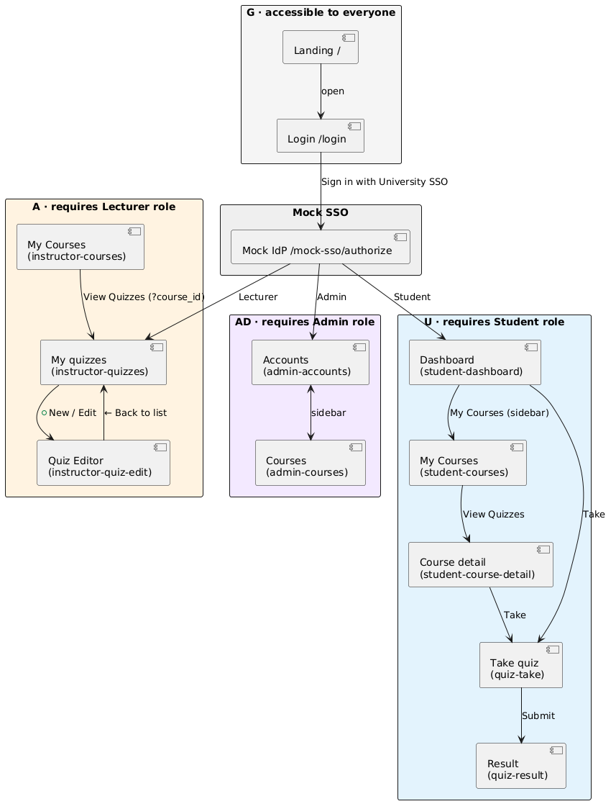

# Milestone 3

## 1. P0 stories and status

| Story | Screen(s) | Route | Status | Issue |
|---|---|---|---|---|
| **US01** — Lecturer creates a quiz (MCQ + short answer) | Quiz Editor | `/ui/html/instructor-quiz-edit.html` (from `instructor-quizzes.html` → **+ New quiz**) | **works** | #59 |
| **US02** — Student sees available quizzes | Dashboard · My Courses · Course detail | `/ui/html/student-dashboard.html` (from `/login`) | **works** | #60 |
| **US03** — Student takes a quiz with countdown timer | Take quiz | `/ui/html/quiz-take.html?quiz_id={id}` (from Dashboard → **Take**) | **works** | #61 |
| **US04** — Automatic grading + immediate score | Quiz result | `/ui/html/quiz-result.html?attempt_id={id}` (after **Submit quiz**) | **works** | #62 |
| **US05** — Lecturer publishes / unpublishes a quiz | My quizzes | `/ui/html/instructor-quizzes.html` (sidebar → **My quizzes**) | **works** | #63 |
| **US06** — Admin manages user accounts | Accounts | `/ui/html/admin-accounts.html` (sidebar → **Accounts**) | **works** | #65 |
| **US11** — Admin creates a course and assigns a lecturer | Courses + Course modal | `/ui/html/admin-courses.html` (sidebar → **Courses** → **+ New course**) | **works** | #66 |
| **US12** — Admin enrolls students into a course | Courses + Roster modal | `/ui/html/admin-courses.html` (sidebar → **Courses** → **Roster** → **+ Add student**) | **works** | #67 |

### Updated screen flow diagram

---

## 2. Wireframes

### 2.1 — Login (`/login`, `/mock-sso/authorize`)

**Route:** `/login` → `/mock-sso/authorize`
**The user comes here to** sign in with their university account and be
redirected to their role’s home page.
**Calls:** `GET /api/me` (via `session.js` — if already authenticated, this
page redirects to the role home instead of showing the form). The
**Sign in** button navigates to `/mock-sso/authorize`; that form POSTs to
`/mock-sso/authorize` and receives `{redirect: "/auth/callback?code=…"}`.

---

### 2.2 — Student dashboard (`/ui/html/student-dashboard.html`) — 4 states

**Route:** `/ui/html/student-dashboard.html`
**The user comes here to** see every quiz they can take right now and every
quiz they have already missed.
**Calls:** `GET /api/quizzes` (via `api.js` — every request adds `?email=…`;
the session cookie takes priority on the server).

**Loading quizzes**:

**No available quiz**:

**Quizzes**:

---

### 2.3 — Student courses (`/ui/html/student-courses.html`)

**Route:** `/ui/html/student-courses.html`
**The user comes here to** see every course they are enrolled in.
**Calls:** `GET /api/student/courses`

---

### 2.4 — Course detail (`/ui/html/student-course-detail.html`)

**Route:** `/ui/html/student-course-detail.html?course_id={id}`
**The user comes here to** see all quizzes for one course, split into
available and overdue.
**Calls:** `GET /api/student/courses/{course_id}/quizzes`

---

### 2.5 — Take quiz (`/ui/html/quiz-take.html`)

**Route:** `/ui/html/quiz-take.html?quiz_id={id}`
**The user comes here to** answer every question of a quiz before the
countdown runs out.
**Calls:**
`POST /api/quizzes/{id}/attempts`,
`PUT  /api/attempts/{id}/answers/{qid}`,
`POST /api/attempts/{id}/tab-switch`,
`POST /api/attempts/{id}/heartbeat`,
`POST /api/attempts/{id}/submit`,
`POST /api/attempts/{id}/release` (via `sendBeacon` on unload)

---

### 2.6 — Quiz result (`/ui/html/quiz-result.html`)

**Route:** `/ui/html/quiz-result.html?attempt_id={id}`
**The user comes here to** see the score of a quiz they just submitted.
**Calls:** `GET /api/attempts/{id}/result`

---

### 2.7 — Instructor courses (`/ui/html/instructor-courses.html`)

**Route:** `/ui/html/instructor-courses.html`
**The user comes here to** see every course assigned to them by the
administrator.
**Calls:** `GET /api/instructor/courses`

---

### 2.8 — Instructor quizzes (`/ui/html/instructor-quizzes.html`)

**Route:** `/ui/html/instructor-quizzes.html` (also `?course_id={id}&code=ACC101`
when reached via **View →** from My Courses)
**The user comes here to** see their quizzes and create, publish, unpublish or
delete them.
**Calls:**
`GET  /api/instructor/quizzes`,
`POST /api/instructor/quizzes/{id}/publish`,
`POST /api/instructor/quizzes/{id}/unpublish`,
`DELETE /api/instructor/quizzes/{id}`

---

### 2.9 — Quiz editor (`/ui/html/instructor-quiz-edit.html`)

**Route:** `/ui/html/instructor-quiz-edit.html` (new quiz) · `?quiz_id={id}` (edit)
**The user comes here to** set the quiz details and add or edit its questions.
**Calls:**
`GET  /api/instructor/courses`,
`POST /api/instructor/quizzes` (create) · `PUT /api/instructor/quizzes/{id}` (edit),
`POST /api/instructor/quizzes/{id}/publish` · `POST /api/instructor/quizzes/{id}/unpublish`,
`POST /api/instructor/quizzes/{id}/questions` · `PUT`/`DELETE .../questions/{qid}`

---

### 2.10 — Admin accounts (`/ui/html/admin-accounts.html`)

**Route:** `/ui/html/admin-accounts.html`
**The user comes here to** create, edit, disable, or delete user accounts.
**Calls:**
`GET  /api/admin/accounts` (with `role`, `status`, `q`, `user_id` filters),
`POST /api/admin/accounts` · `GET /api/admin/accounts/{id}`,
`PATCH /api/admin/accounts/{id}` · `DELETE /api/admin/accounts/{id}`

---

### 2.11 — Admin courses — list (`/ui/html/admin-courses.html`)

**Route:** `/ui/html/admin-courses.html`
**The user comes here to** create courses, assign one lecturer per course, and
open the roster to enroll students.
**Calls:** `GET /api/admin/courses`

---

### 2.12 — Admin courses — Course modal (create / edit)

**Opened by:** **+ New course** (empty form) or **Edit** (prefilled).
**The user comes here to** create a course or change its code, name, or
assigned lecturer.
**Calls:**
`GET  /api/admin/accounts?role=Lecturer` (populate dropdown),
`POST /api/admin/courses` (create) · `PUT /api/admin/courses/{id}` (edit)

---

### 2.13 — Admin courses — Roster modal (+ Add student)

**Opened by:** **Roster** in the course list.
**The user comes here to** see everyone enrolled in one course, add a student,
or remove a student.
**Calls:**
`GET  /api/admin/courses/{id}/roster`,
`POST /api/admin/courses/{id}/enrollments`,
`DELETE /api/admin/courses/{id}/enrollments/{student_id}`

---

## 3. Error messages

| API code | Business rule | The exact message the user sees |
|---|---|---|
| `409 Conflict` | **BR1** — one active attempt per student at a time | *“You already have an active attempt on 'ACC101 Midterm Quiz'. Submit it (or let its timer expire) before starting another quiz.”* — shown on `/ui/html/quiz-take.html` with a **Resume active quiz** button |
| `422 Unprocessable` | **BR2** — time limit must be 5–120 minutes | *“Time limit must be between 5 and 120 minutes.”* — shown in the alert area of the Quiz Editor |
| `422 Unprocessable` | **BR4** — each MCQ must have exactly one correct option | *“Mark exactly one option as correct.”* — shown under the MCQ options in the Add/Edit question modal |
| `422 Unprocessable` | **BR8** — only Student accounts can be enrolled | *“lanpt@univ.edu is a Lecturer, not a Student.”* — shown in the **Add student** form on the Admin Courses roster |
| `409 Conflict` | **BR9** — a lecturer who owns courses cannot be demoted away from Lecturer | *“This lecturer still owns 2 course(s). Reassign those courses to another lecturer before changing the role (BR9).”* — shown in the Edit-account modal on the Admin Accounts page |
| `409 Conflict` | — Admin cannot delete or disable their own account | *“You cannot delete your own account.”* — shown as a red alert at the top of the Admin Accounts page |

---

## 4. What changed since M2

**`QuizListItem` gained an `availability` field, and two new student endpoints
were added — `GET /api/student/courses` and
`GET /api/student/courses/{id}/quizzes`.**

The M2 dashboard hid every quiz whose due date had already passed. Building the
dashboard wireframe forced us to look at the student's actual mental
model, and it was wrong: a student who missed a quiz still needs to *see* it —
otherwise the dashboard actively erases evidence of work they owe. Two visible
consequences:

1. **`QuizListItem.availability ∈ {"available", "overdue"}`.** The M2
   `WALKING_SKELETON_SQL` filtered rows with `due_at > NOW()` at the SQL level,
   so overdue quizzes never reached the client. We removed that filter and let
   the client render the two groups side-by-side (see §2.2).
2. **Two new endpoints.** Once students could see all their quizzes together,
   the next thing the same student asked for was *“let me look at one course at
   a time”* — which the M2 API could not express. We added
   `GET /api/student/courses` (list the courses the caller is enrolled in) and
   `GET /api/student/courses/{id}/quizzes` (list the quizzes in one course,
   split by `availability`). Both are wired into
   `student-courses.html` and `student-course-detail.html` (§2.3 and §2.4).